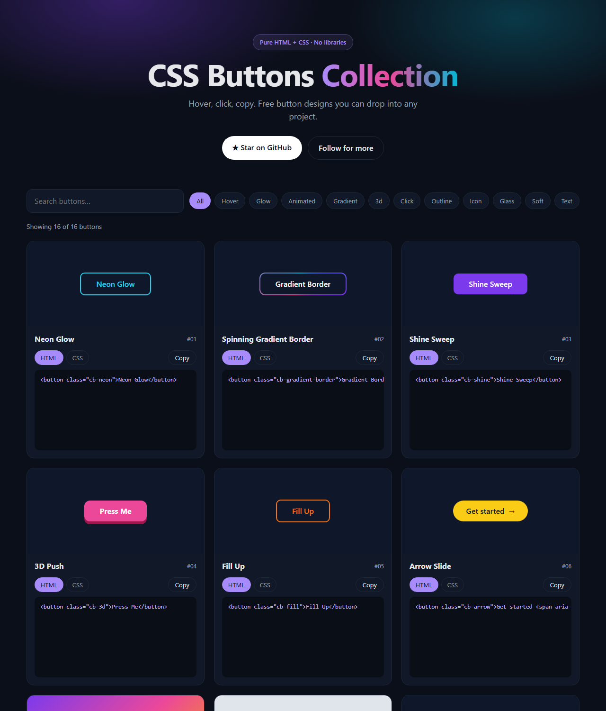

<h1 align="center">CSS Buttons Collection</h1>

<p align="center">
  Free, copy-paste button designs made with pure HTML and CSS.<br />
  No libraries, no frameworks, no build step.
</p>

<p align="center">
  <a href="https://skygitig.github.io/css-buttons-collection/"><strong>Live demo →</strong></a>
</p>

<p align="center">
  
  
  
  
</p>

<p align="center">
  
</p>

## How to use

1. Open the [live demo](https://skygitig.github.io/css-buttons-collection/) and find a button you like.
2. Click **HTML**, then **Copy**, and paste the markup into your page.
3. Click **CSS**, then **Copy**, and paste the styles into your stylesheet.

Each button is standalone. Its classes start with `cb-`, so it won't clash with your existing styles.

## What's inside

| # | Button | Style |
|---|---|---|
| 01 | Neon Glow | Hover, glow |
| 02 | Spinning Gradient Border | Animated, gradient |
| 03 | Shine Sweep | Hover, gradient |
| 04 | 3D Push | Depth, click |
| 05 | Fill Up | Hover, outline |
| 06 | Arrow Slide | Hover, icon |
| 07 | Glassmorphism | Glass, hover |
| 08 | Neumorphism | Soft, click |
| 09 | Pulse Ring | Animated, glow |
| 10 | Border Draw | Hover, outline |
| 11 | Neo-Brutalist | Click, depth |
| 12 | Text Swap | Hover, text |
| 13 | Rainbow Flow | Animated, gradient |
| 14 | Icon Expand | Hover, icon |
| 15 | Underline Slide | Hover, text |
| 16 | Shadow Lift | Hover, depth |

New buttons are added regularly. Star the repo to follow along.

## Run it locally

```bash
git clone https://github.com/skygitIG/css-buttons-collection.git
cd css-buttons-collection
```

Then open `index.html` in your browser.

## Add a button

All buttons live in [`assets/buttons.js`](assets/buttons.js). To add one, append an object with a `name`, `tags`, `html` and `css`, and prefix your classes with `cb-`. Pull requests are welcome.

## Browser support

All buttons work in current versions of Chrome, Edge, Firefox and Safari. The spinning gradient border uses `@property`, which needs Firefox 128 or later. Animated buttons stop moving for visitors who turn on reduced motion.

## License

[MIT](LICENSE). Use these buttons in personal and commercial projects.

---

<p align="center">
  Made by <a href="https://github.com/skygitIG">Akash Kumar</a> ·
  <a href="https://www.instagram.com/skygitig/">Instagram</a> ·
  <a href="https://codewithsky.com">codewithsky.com</a>
</p>
